# US survey plan

A survey of where people in the United States can ask about fostering or adopting, what each first-contact form asks, what reply each front door promises, what the full application asks, and what the rules for becoming a foster or adoptive parent are in each state. It is the project's first adaptation outside England (see "Later: adopt" in the [roadmap](roadmap.md)).

Data lives in [`register/us/`](../register/us/). Column definitions are in its [README](../register/us/README.md).

<!-- summary:start (generated by tools/us_summary.py; do not edit by hand) -->

## At a glance

*Counted from the files in [`register/us/`](../register/us/) on 2026-11-18. Every row is a lead to check until a person has verified it. Charts follow your light or dark theme; each has a table view.*

<p align="center">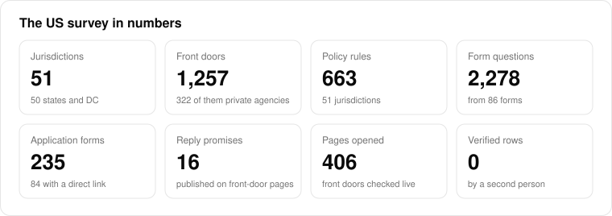</p>

<p align="center">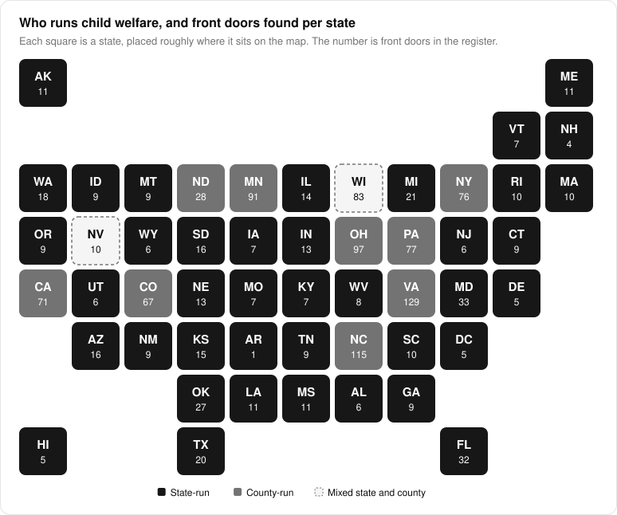</p>

<details><summary>Table view: who runs child welfare</summary>

| Model | Jurisdictions | Which |
|---|---:|---:|
| County-run | 9 | CA, CO, MN, NC, ND, NY, OH, PA, VA |
| Mixed | 2 | NV, WI |
| State-run | 40 | AK, AL, AR, AZ, CT, DC, DE, FL, GA, HI, IA, ID, IL, IN, KS, KY, LA, MA, MD, ME, MI, MO, MS, MT, NE, NH, NJ, NM, OK, OR, RI, SC, SD, TN, TX, UT, VT, WA, WV, WY |

</details>

### Progress

```mermaid
flowchart LR
    P1["1 Structure"]:::done
    P2["2 States"]:::partial
    P3["3 Front doors"]:::partial
    P4["4 Enquiry forms<br>and reply promises"]:::partial
    P5["5 Application forms"]:::partial
    P6["6 Policies"]:::partial
    P7["7 Private agencies"]:::partial
    P8["8 Patterns summary"]:::partial
    P9["9 Verification"]:::todo
    P1 --> P2 --> P3 --> P4 --> P5 --> P6 --> P7 --> P8 --> P9
    classDef done fill:#171717,stroke:#171717,color:#fafafa
    classDef partial fill:#737373,stroke:#737373,color:#ffffff
    classDef todo fill:#f5f5f5,stroke:#a1a1a1,color:#0a0a0a,stroke-dasharray:4 3
```

Black: done. Grey: first pass, unverified. Light, dashed: not started.

<p align="center">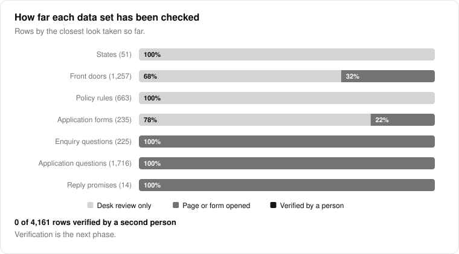</p>

<details><summary>Table view: how far each data set has been checked</summary>

| Data set | Rows | Page or form opened | Verified |
|---|---:|---:|---:|
| States | 51 | 0 | 0 |
| Front doors | 1257 | 406 | 0 |
| Policy rules | 663 | 0 | 0 |
| Application forms | 235 | 51 | 0 |
| Enquiry questions | 552 | 552 | 0 |
| Application questions | 1716 | 1716 | 0 |
| Reply promises | 16 | 16 | 0 |

</details>

## Who the front doors are

<p align="center">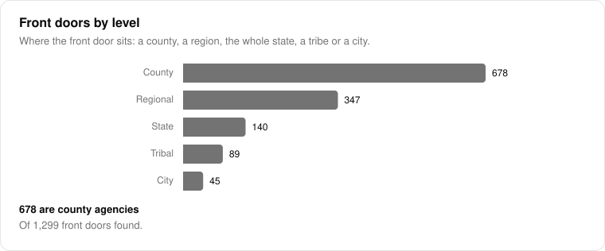</p>

<p align="center">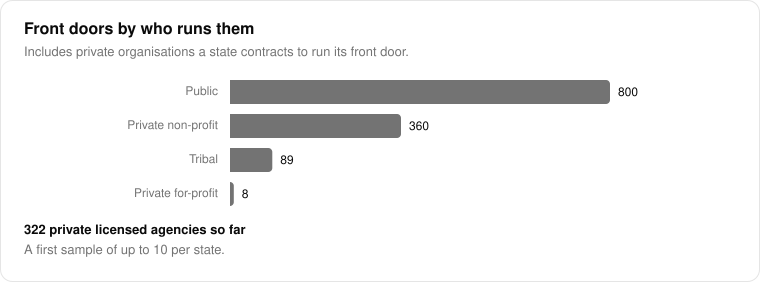</p>

<details><summary>Table view: front doors by level and by who runs them</summary>

| Group | Front doors |
|---|---:|
| County | 678 |
| Regional | 316 |
| State | 129 |
| Tribal | 89 |
| City | 45 |
| Public | 800 |
| Private non-profit | 360 |
| Tribal | 89 |
| Private for-profit | 8 |

</details>

## What the data shows so far

Neutral counts across front doors and states. No front door is scored or ranked, and every figure rests on unverified rows, so read these as early patterns to check, not findings.

- **Enquiry forms mostly ask for contact details.** All 68 first-contact forms read ask for a name and an email address. 76% ask for a phone number, 26% for a street address and 7% for a date of birth or age.
- **Few front doors publish a reply time.** 15 of the 406 front-door pages opened state one, from 1 to 14 days.
- **The usual minimum age is 21.** 40 of 48 jurisdictions with a recorded figure set it; the others set 18 or 19.
- **The most common pre-service training is 20-29 hours** (14 of 37 jurisdictions with a figure).
- **Application forms ask far more than enquiry forms.** 88% of the 17 fillable forms read ask for a date of birth, and most ask about relationships, work, education and who lives in the home.

### What people are asked

<p align="center">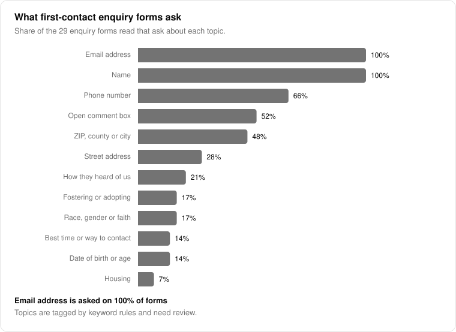</p>

<details><summary>Table view: what enquiry forms ask</summary>

| Topic | Share of forms (%) |
|---|---:|
| Email address | 100 |
| Name | 99 |
| Phone number | 76 |
| Open comment box | 72 |
| ZIP, county or city | 38 |
| Street address | 26 |
| How they heard of us | 16 |
| Fostering or adopting | 15 |
| Race, gender or faith | 10 |
| Best time or way to contact | 7 |
| Date of birth or age | 7 |
| Consent to contact | 3 |

</details>

<p align="center">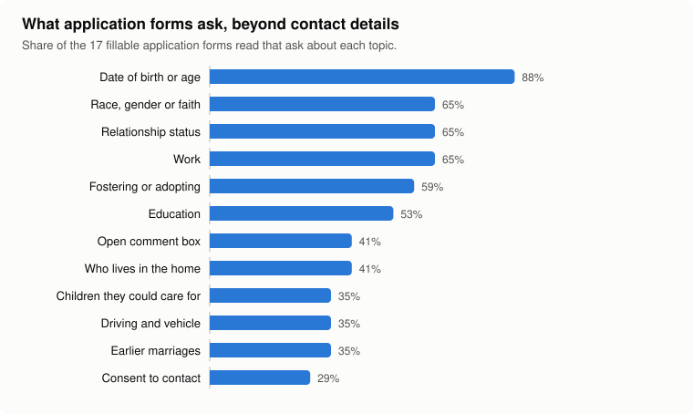</p>

<details><summary>Table view: what application forms ask</summary>

| Topic | Share of forms (%) |
|---|---:|
| Date of birth or age | 88 |
| Race, gender or faith | 65 |
| Relationship status | 65 |
| Work | 65 |
| Fostering or adopting | 59 |
| Education | 53 |
| Open comment box | 41 |
| Who lives in the home | 41 |
| Children they could care for | 35 |
| Driving and vehicle | 35 |
| Earlier marriages | 35 |
| Consent to contact | 29 |

</details>

### What front doors promise

<p align="center">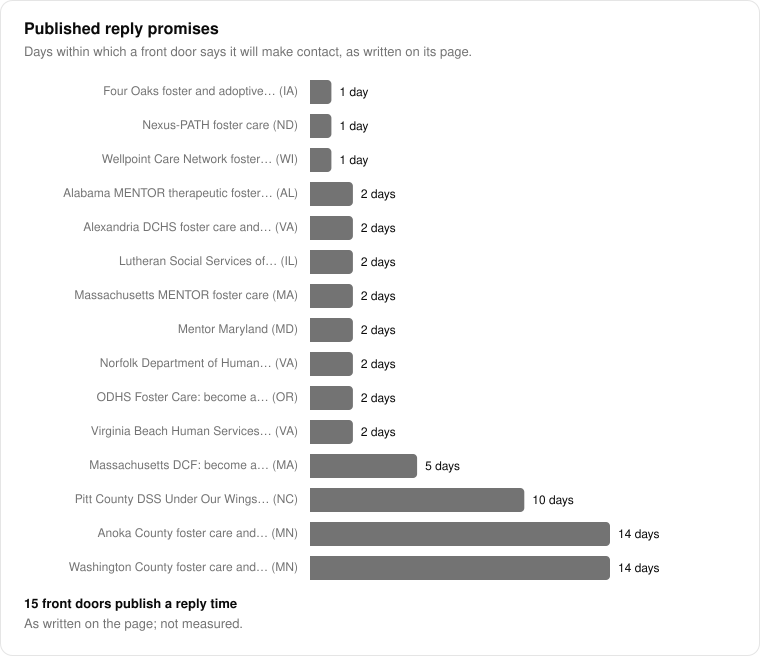</p>

<details><summary>Table view: published reply promises</summary>

| Front door | Days |
|---|---:|
| Four Oaks foster and adoptive… (IA) | 1 |
| Nexus-PATH foster care (ND) | 1 |
| Wellpoint Care Network foster… (WI) | 1 |
| Alabama MENTOR therapeutic foster… (AL) | 2 |
| Alexandria DCHS foster care and… (VA) | 2 |
| Lutheran Social Services of… (IL) | 2 |
| Massachusetts MENTOR foster care (MA) | 2 |
| Mentor Maryland (MD) | 2 |
| Norfolk Department of Human… (VA) | 2 |
| ODHS Foster Care: become a… (OR) | 2 |
| Virginia Beach Human Services… (VA) | 2 |
| Massachusetts DCF: become a… (MA) | 5 |
| Pitt County DSS Under Our Wings… (NC) | 10 |
| Anoka County foster care and… (MN) | 14 |
| Washington County foster care and… (MN) | 14 |

</details>

### Rules across states

<p align="center">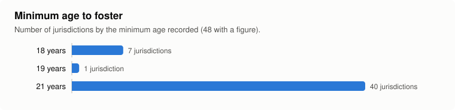</p>

<details><summary>Table view: minimum age to foster</summary>

| Minimum age | Jurisdictions |
|---|---:|
| 18 | 7 |
| 19 | 1 |
| 21 | 40 |

</details>

<p align="center">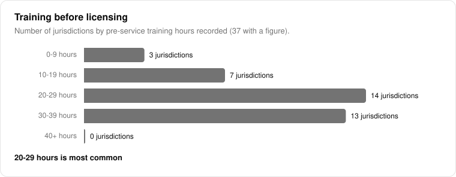</p>

<details><summary>Table view: training before licensing</summary>

| Hours | Jurisdictions |
|---|---:|
| 0-9 hours | 3 |
| 10-19 hours | 7 |
| 20-29 hours | 14 |
| 30-39 hours | 13 |
| 40+ hours | 0 |

</details>

<p align="center">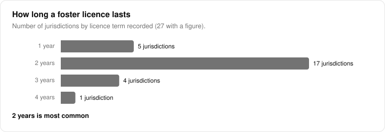</p>

<details><summary>Table view: how long a foster licence lasts</summary>

| Licence term | Jurisdictions |
|---|---:|
| 1 year | 5 |
| 2 years | 17 |
| 3 years | 4 |
| 4 years | 1 |

</details>

<!-- summary:end -->

## Scope

- **In:** the 50 states, the District of Columbia and tribal nations.
- **Front doors:** every public place to enquire: the state agency, county or city agencies where they run services, private organisations contracted by a state to recruit or license families for it, and tribal child welfare programmes.
- **Applications and policies:** the forms that make up a foster or adoption application after the first enquiry, and each state's published rules on who can foster or adopt and what licensing involves.
- **Later phase:** private licensed child-placing agencies that are not contracted front doors.
- **Out:** territories (for now), any child-level data, any scoring or ranking of named agencies.

## Why counties matter

In most states the state agency runs child welfare. In county-administered states, counties (or cities, or human service zones) run it. Each has its own front door. Those states are recorded as `county_administered` or `hybrid` in `states.csv`, and their local agencies appear in `front-doors.csv` at `level` `county` or `city`.

In some state-administered states, the state contracts private organisations by region to recruit and license families (for example Florida's Community-Based Care lead agencies). Those organisations are the front door for that region, so they are recorded at `level` `regional` with `contracted` set to `yes`.

## Tribal nations

Tribes are sovereign nations, and many run their own child welfare programmes. The first pass lists:

1. every tribe or consortium with an approved Title IV-E plan to run foster care directly, then
2. tribal programmes that publicly recruit or license foster or adoptive homes, found by searching state by state.

Each row's `notes` says which rule selected it. The list is not complete. Many tribes work with families through state or county agencies under the Indian Child Welfare Act, or recruit by word of mouth. A tribe missing from the register does not mean it has no programme.

## Phases

| Phase | What | Status |
|---|---|---|
| 1 | Structure: folders, column guide, topic codes, validation test | Done |
| 2 | `states.csv`: 50 states and DC, administration model, lead agency, main pages | First pass |
| 3 | `front-doors.csv`: state, regional contracted, county or city, and tribal front doors | First pass |
| 4 | Open each front-door page and form; fill `form-questions.csv` and `response-promises.csv` | First pass (crawler) |
| 5 | Application forms: list each state's (and each local or tribal agency's own) application forms in `application-forms.csv`; record their questions in `application-questions.csv` | Forms listed; questions read from 17 fillable PDFs (first pass) |
| 6 | Policies: each state's published rules for fostering and adopting in `policies.csv`, with the legal citation | First pass |
| 7 | Private licensed agencies, starting from each state's licensing list | First pass (sample of up to 10 per state) |
| 8 | Neutral patterns summary (counts across front doors and states, no names ranked) | First pass ("What the data shows so far", above) |
| 9 | Verification by a second person, and an invitation to agencies to correct their rows | Not started |

## Method

### Phases 2 and 3: desk review by web search

Research ran in batches: five batches of about ten states each, one tribal batch, then batches for the county-administered states.

The first pass was done from a cloud sandbox whose network policy blocks direct page fetches. So every row comes from **web search results**: the URL appeared in the results, and the facts come from the result text. The page itself was not opened. Those rows carry `evidence_level` `search_result`. Researchers used only URLs that appeared in search results and never built or guessed a URL.

This is the same standing as the English register's seed: leads to check, not facts.

### Phase 4: forms and response promises

Phase 4 needs the pages opened. Two routes:

- **By hand**, one form at a time, recording fields with `evidence_level` `form_read`.
- **A polite crawler** (the roadmap's planned crawler). It must respect robots.txt, identify itself with a project URL, wait several seconds between requests to the same site, read public pages only and never submit a form.

Questions are paraphrased in a few words and tagged with a topic from [`question-topics.md`](../register/us/question-topics.md). Forms are never copied whole. Consent text and response promises may be quoted briefly with their source.

"SLA" here means **only what a front door publishes**: for example "a recruiter will call you within 48 hours". The survey does not measure whether agencies keep those promises. That would need their own data, and would come later and only by agreement.

### Phase 5: application forms

An application is usually a packet, not one form: an application, then forms for background checks, a medical statement, references, finances, a home safety check and a home study. Phase 5 records them in two steps.

1. **Find the forms.** For each state, list the forms in the state's licensing or adoption application packet in [`application-forms.csv`](../register/us/application-forms.csv): name, form number, issuing body, which step it belongs to, format and link. In county-run states, list the state's standard forms first, then any local agency that publishes its own. Tribal agencies that publish their own forms are listed too. This step can be done from search results.
2. **Record the questions.** Open each form and record each question in [`application-questions.csv`](../register/us/application-questions.csv), paraphrased in a few words and tagged with a topic from [`question-topics.md`](../register/us/question-topics.md). This step needs the form opened (`evidence_level` `form_read`).

Rules for this phase:

- **Describe, do not copy.** Forms are paraphrased question by question and never republished, even where a state form is in the public domain.
- **Licensed instruments stay out.** Several states use licensed home study and training models, for example the SAFE home study, PRIDE and the National Training and Development Curriculum (NTDC). Record that a state uses one, with a link to the publisher. Do not record their questions or content. This follows the rule on CoramBAAF's Form F in England.
- **Sensitive questions are expected here.** A full application properly asks about criminal history, health and finances. The rubric's first-contact rule on sensitive questions does not apply to this stage. The topic codes still mark these questions, so the summary can say what is asked and when.
- **No applicant data.** Blank forms only. Never a completed form, an example answer or anything an applicant has written.

### Phase 6: policies

[`policies.csv`](../register/us/policies.csv) holds one row per rule, per state: for example the minimum age to foster, whether renting is allowed, bedroom and space rules, training hours, background checks, the home study, licence length, and the stated time from application to licence. Topics are listed in [`policy-topics.md`](../register/us/policy-topics.md).

- **Primary source first.** Each rule should cite the statute or regulation (for example a section of the state administrative code) where one exists, then the agency page that explains it. `source_type` says which.
- **Plain paraphrase.** `rule_summary` says the rule in plain words. A machine-readable `value` and `unit` are added where the rule is a number, such as `21` `years`.
- **Fostering and adoption kept apart.** Rules often differ, so `applies_to` says which.
- **Rules, not judgements.** The register records what a state's rule is. It does not say whether a rule is good or bad, and it does not assess any person against the rules.
- **Dates matter.** Rules change. `effective_date` is recorded when the source gives one.

Policies can be found through search results, but the wording of a regulation should be checked against the code itself before a row is marked `page_read`.

### Phase 7: private agencies

Start from each state's public list of licensed child-placing agencies (`licensing_lookup_url` in `states.csv`). First take a sample per state, chosen by a written rule such as the first ten alphabetically within each region. Then widen.

## Rules that apply throughout

These come from [`CLAUDE.md`](../CLAUDE.md):

- No personal data. No staff names, phone numbers or email addresses. The test checks for phone numbers and email addresses.
- Neutral facts only. No scores for named agencies until the rubric has been consulted on and each agency has had a right of reply.
- Every row has a source link and a date checked.
- Licensed forms and licensed assessment or training models are not reproduced.

## Checks

```
python tools/us_summary.py
python tests/validate_us_register.py
```

`tools/us_summary.py` rebuilds the "At a glance" section at the top of this page from the CSV files. Run it after changing any data file; the test fails if the summary no longer matches the data.

The test checks headers, allowed values, required cells, URL shape, dates, unique IDs, links between files, and the personal-data guards.

## Progress log

**2026-11-14, wave 1.** Five state batches and a tribal batch. Result: 51 rows in `states.csv`, 120 in `front-doors.csv` (71 state, 32 regional, 1 county, 16 tribal). The session allows 200 web searches per turn, shared by all agents, and that ran out part way through. So:

- several lead-agency home pages and most licensing lookups are blank
- many `administration` values for state-administered states rest on the Child Welfare Information Gateway factsheet without the state map being visible; the row notes say so
- the five county batches started after the budget was spent and wrote nothing; they will rerun one or two at a time
- the tribal batch finished the Title IV-E pass (10 of about 22 approved tribes identified) but not the state-by-state search; see [`register/us/notes/tribal-search-2026-11-14.md`](../register/us/notes/tribal-search-2026-11-14.md)

**2026-11-14, wave 2.** County batches rerun two at a time, each agent capped at 90 searches and told to write directory-sourced rows first. Then a second tribal pass. Result: 935 front doors in all.

| Level | Rows |
|---|---|
| state | 71 |
| regional (contracted regions, multi-county agencies, North Dakota zones, joint county-city departments) | 71 |
| county | 673 |
| city | 31 |
| tribal | 89 |

Every county-run state now has a row for each local agency the sources list: CA 58, CO 61 (64 counties), MD 24, MN 78 (the state source says 79), NV 2 plus the state rural region, NY 58, NC 100, ND 19 zones, OH 85, PA 66 (67 counties), VA 120, WI 71 plus Milwaukee. 415 of the 935 rows have the front door's own page as `website`; the rest cite a state directory or another source. Four rows carry a published response time.

Tribal rows: 10 selected from the Title IV-E list and 79 from search. About 10 approved Title IV-E tribes are still unnamed because the Children's Bureau list never showed its names in search results; opening that page by hand is the quickest fix. Notes: [`register/us/notes/tribal-search-2026-11-14-pass-2.md`](../register/us/notes/tribal-search-2026-11-14-pass-2.md).

Points raised by the county batches, recorded in row notes: several counties route foster enquiries to private partner agencies (for example Franklin OH, Allegheny PA, Westchester NY, Boulder CO, Kenosha WI); Burke County NC moved to a single contractor in 2025–26; North Dakota moved foster licensing from zones to the state in 2022; some Virginia joint departments are unclear.

**2026-11-15, wave 3: policies and application forms.** Five policy batches and three form-listing batches, each agent capped at 60 to 90 searches.

*Policies* (`policies.csv`): 663 rows covering all 51 jurisdictions, 9 to 18 per state. 373 rows carry a statute or regulation citation. Best covered: minimum age, pre-service and ongoing training, capacity, board rates, background checks and bedroom rules. Thinly covered: time from application to licence (6 rows), fees (6), renting (19), and smoking, firearms and pets (almost none). Sources often disagree, above all on training hours and capacity; where they clash no `value` is recorded and the notes give each figure. Rules have recently changed or are pending in at least ten states (for example WA, WI, MD, CO, OK, NJ, IA), and rows that may be out of date say so. In county-run states only statewide rules were recorded.

*Application forms* (`application-forms.csv`): 235 forms across all 51 jurisdictions. 84 have a direct link to the blank form; the rest are known by title and number from manuals and policy text. 14 rows are online portals (for example New Jersey, Rhode Island, Hawaii, Utah, Washington). 12 rows are local, regional or tribal agencies' own forms. 6 rows are licensed models (SAFE home study, NTDC, PS-MAPP), listed with no link or content. Several states have no single state application because local offices or contracted agencies issue their own (for example Maryland, Nebraska, Wisconsin), and few states have a separate adoption application. Forms that could not be tied to a page naming them were left out. No form questions have been recorded: that needs the forms opened.

The validator's phone-number guard was tuned during this wave: Oregon and Washington administrative rule numbers (OAR 413-200-0348, WAC 110-148-1365) share a phone number's shape, so a number written after "OAR" or "WAC" is not treated as a phone number. Policies gained a `usd_per_day` unit for states that publish daily board rates.

**2026-11-17, wave 4: private agencies.** Five batches, each capped at 45 to 50 searches. Result: 322 private licensed child-placing agencies in `front-doors.csv` across 50 jurisdictions (none found for Arkansas, where the state partners with private agencies through Every Child Arkansas but no names surfaced). Up to 10 per state, chosen first from a state list in the order the source gives (131 rows, `selection: state-list`), then from search. 101 have their own website. Sector is assumed non-profit unless a source said otherwise, and each row says so; 8 are marked for-profit.

Many state lists are old (for example Missouri 2009, DC about 2011, Alabama 2018) or only partly visible in search results. Many private agencies recruit or license families under a state, county or city contract (for example Rhode Island's foster care agencies, New York City and Philadelphia providers, Kentucky and Maine treatment foster care). Those rows keep `contracted` as `no`, as the sample rule set, and say so in notes; deciding which are really contracted front doors is a verification task.

The page now opens with an "At a glance" summary built by `tools/us_summary.py` from the CSVs.

**2026-11-17, wave 5: pages opened.** With full network access, `tools/polite_fetch.py` fetched every front-door website and form link (539) and every application form with a direct link (84), politely: robots.txt respected, the crawler identified itself, at least 5 seconds between requests to a site, GET only, nothing submitted. Results:

- 398 front doors moved to `page_read` or `form_read` (the page loaded and names the front door). 36 dead links are noted on their rows.
- `form-questions.csv`: 225 questions from 29 enquiry forms. `response-promises.csv`: 14 published reply promises, from 24 hours to two weeks.
- `application-questions.csv`: 1,716 questions from 17 fillable PDF forms that applicants complete. Forms with no fillable fields, and forms completed with agency staff, are listed for reading by hand.
- 50 front-door links and 8 form links were blocked (403), and 26 were refused by robots.txt. None was retried or worked around.
- The Children's Bureau Title IV-E list is behind a bot challenge and still needs opening by hand.

Details: [`register/us/notes/crawl-2026-11-17.md`](../register/us/notes/crawl-2026-11-17.md). Topic tags come from keyword rules; a person should review both question files before analysis.

Points to check in the next pass include Maryland (its 2025–2029 plan calls it state-supervised and state-administered, with 24 local departments), Ohio's agency count (85 against 88 counties), Minnesota's (79 agencies for 87 counties) and North Dakota (19 human service zones, licensing moved to the state in 2022).

## Known limits of the first pass

- Every row is unverified, and most come from search results only.
- Search results can be out of date. Agencies change contractors, rename programmes and move pages.
- County coverage depends on what search turned up. Where a county's own page was not found, the row still lists the county as a front door, with the state directory as its source and a blank `website`.
- Tribal coverage is partial by design (see above).
